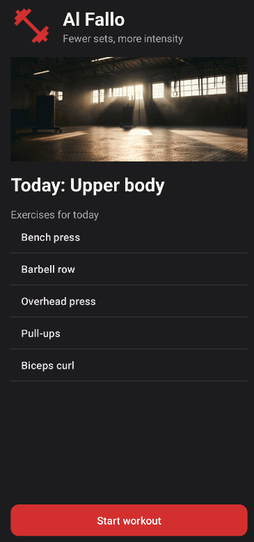
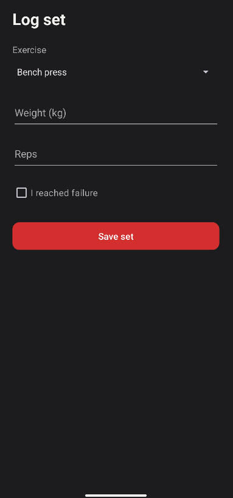
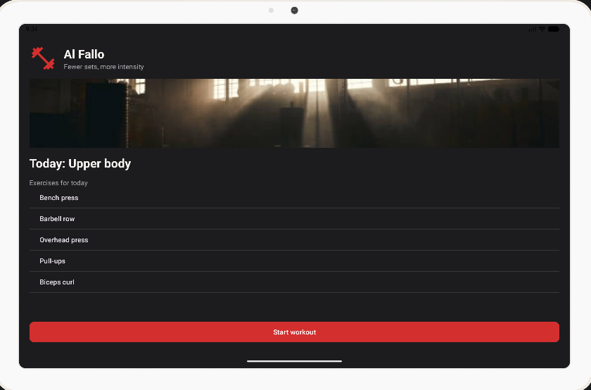
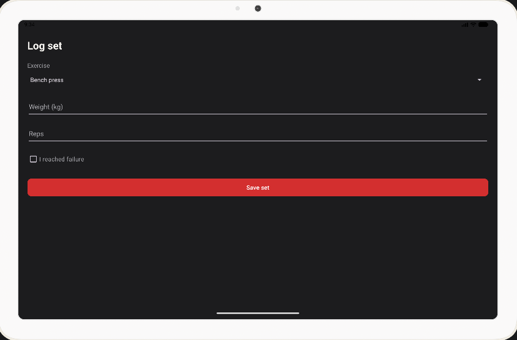

# Al Fallo

Práctica 1 de PMDM (Programación Multimedia y Dispositivos Móviles) · Jorge Moreno Rivero

## Qué es

Al Fallo es una app Android para apuntar entrenamientos de gimnasio de alta intensidad: pocas series, pero llevadas hasta el fallo muscular. En esta práctica solo está hecha la interfaz de dos pantallas: la de inicio, con el entreno del día, y la de registro de una serie. Los botones todavía no guardan nada.

Está hecha en Java con vistas XML y tiene textos en español e inglés, paleta de colores propia, estilos, tema personalizado e icono adaptativo.

## Capturas

| Inicio (móvil) | Registro (móvil) | Inicio (tablet) | Registro (tablet) |
|---|---|---|---|
|  |  |  |  |

## Cómo ejecutarla

1. Clona el repositorio: `git clone https://github.com/JorgeMorenoRivero/PMDM_P1_JorgeMorenoRivero.git`
2. Ábrelo con Android Studio (File → Open) y espera a que termine la sincronización de Gradle.
3. Crea un emulador desde Device Manager o conecta un móvil Android (API 24 o superior).
4. Pulsa Run.

## Memoria

La memoria de la práctica está en [docs/memoria.pdf](docs/memoria.pdf).
